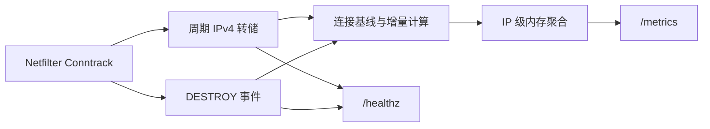

<div align="center">

# Conntrack Network Traffic Exporter

基于 Linux Netfilter Conntrack 的主机网络流量 Prometheus Exporter


[快速开始](#快速开始) · [指标](#prometheus-指标) · [Grafana](#grafana-dashboard) · [工作原理](#工作原理) · [故障排查](#故障排查)

</div>

在不支持现代 eBPF 能力的旧版 Linux 主机上，按源 IP、目标 IP、流量方向和公网/内网类型持续统计网络流量。项目直接读取内核 Conntrack 计数，通过 `/metrics` 暴露 Prometheus 指标，不依赖 eBPF、TC、libpcap、gopacket、内核头文件或 CGO。

适用于 CentOS 7 / Linux 3.10 等端点主机，也可用于物理机、虚拟机、应用服务器、数据库和中间件的流量观察。

> [!NOTE]
> NAT 流量映射和字节统计已在目标环境完成实测验证；项目同时通过了单元测试、竞态检测和 Linux/amd64 静态构建。部署到新的内核、网络拓扑或高负载环境前，仍建议执行本文的目标主机验证。

## 主要能力

- 保持 `network_traffic_bytes_total{src_ip,dst_ip,direction,ip_type}` 指标结构，兼容仓库自带 Grafana Dashboard。
- 周期性转储 IPv4 Conntrack 表，并订阅 `DESTROY` 事件补齐短连接和连接尾部流量。
- 首次转储仅建立基线，避免把启动前的历史连接流量一次性计入指标。
- 分别识别 `inbound` 与 `outbound`，并支持端点侧常见的单级 DNAT/SNAT 映射。
- Prometheus 抓取只读取内存快照，不会在 HTTP 请求链路中触发 Conntrack 转储。
- 提供转储、重连、丢弃、跳过、计数器重置和事件监听等自监控指标。
- `/healthz` 同时检查转储新鲜度与 `DESTROY` 事件监听状态。

## 快速开始

### 1. 准备环境

运行环境需要满足：

- Linux 已启用 Netfilter Conntrack 和 Conntrack Netlink 支持；
- Go 1.21 或更高版本，仅构建时需要；
- 使用 root 运行，或为二进制授予 `CAP_NET_ADMIN`；
- `net.netfilter.nf_conntrack_acct` 和 `net.netfilter.nf_conntrack_events` 均为非零值；
- 目标网卡至少配置一个 IPv4 地址。

启用 Conntrack 计数和事件：

```bash
sudo sysctl -w net.netfilter.nf_conntrack_acct=1
sudo sysctl -w net.netfilter.nf_conntrack_events=1
```

如需永久生效，可写入 sysctl 配置：

```bash
printf '%s\n' \
  'net.netfilter.nf_conntrack_acct = 1' \
  'net.netfilter.nf_conntrack_events = 1' \
  | sudo tee /etc/sysctl.d/90-conntrack-accounting.conf
sudo sysctl --system
```

> [!NOTE]
> Exporter 启动时只检查配置，不会自动修改 sysctl 或 capability。

### 2. 构建

```bash
git clone --branch conntrack https://github.com/luozijian1990/network-traffic-ebpf-exporter.git
cd network-traffic-ebpf-exporter
make build
```

生成的 `conntrack-traffic-exporter` 是不依赖 CGO 的单一二进制。等效构建命令为：

```bash
CGO_ENABLED=0 go build -o conntrack-traffic-exporter ./cmd/exporter
```

### 3. 运行

使用 root：

```bash
sudo ./conntrack-traffic-exporter \
  --iface eth0 \
  --addr :9091 \
  --dump-interval 30s \
  --max-entries 10240
```

或仅授予所需 capability：

```bash
sudo setcap cap_net_admin=+ep ./conntrack-traffic-exporter
./conntrack-traffic-exporter --iface eth0
```

确认服务状态：

```bash
curl -i http://localhost:9091/healthz
curl http://localhost:9091/metrics
```

> [!IMPORTANT]
> `/metrics` 与 `/healthz` 没有内置认证或 TLS。生产环境应通过监听地址、防火墙或反向代理限制访问范围。

## 配置参数

| 参数 | 默认值 | 说明 |
| --- | --- | --- |
| `--iface` | `eth0` | 使用该接口的 IPv4 地址判断本机侧；不会在接口上挂载程序 |
| `--addr` | `:9091` | HTTP 监听地址 |
| `--dump-interval` | `30s` | 完整 IPv4 Conntrack 表的转储间隔 |
| `--max-entries` | `10240` | IP 级聚合键数量上限 |

聚合表达到上限后，已有键仍会继续累加，新键会被丢弃并计入 `network_conntrack_dropped_keys_total`。当前实现不使用 LRU 或 Top-N 淘汰策略。

## Prometheus 指标

核心指标是 Exporter 进程生命周期内持续累加的计数器：

```text
network_traffic_bytes_total{src_ip="10.0.0.5",dst_ip="8.8.8.8",direction="outbound",ip_type="public"} 12345
```

| 标签 | 含义 |
| --- | --- |
| `src_ip` | 当前统计元组的源 IPv4 地址 |
| `dst_ip` | 当前统计元组的目标 IPv4 地址 |
| `direction` | `inbound` 或 `outbound` |
| `ip_type` | 根据 `dst_ip` 判断的 `private` 或 `public` |

常用 PromQL：

```promql
# 入站/出站总速率
sum by (direction) (rate(network_traffic_bytes_total[1m]))

# 入站流量来源 Top 10
topk(10, sum by (src_ip) (
  rate(network_traffic_bytes_total{direction="inbound"}[1m])
))

# 出站流量目标 Top 10
topk(10, sum by (dst_ip) (
  rate(network_traffic_bytes_total{direction="outbound"}[1m])
))
```

自监控指标：

<details>
<summary>查看完整列表</summary>

| 指标 | 用途 |
| --- | --- |
| `network_conntrack_dump_duration_seconds` | Conntrack 转储耗时 |
| `network_conntrack_dump_entries` | 最近一次成功转储的连接数 |
| `network_conntrack_dump_errors_total` | 转储失败总数 |
| `network_conntrack_consecutive_failures` | 当前连续转储失败次数 |
| `network_conntrack_reconnects_total` | 转储 Netlink socket 重连次数 |
| `network_conntrack_last_success_timestamp_seconds` | 最近成功转储时间 |
| `network_conntrack_previous_entries` | 当前保留的连接基线数 |
| `network_conntrack_agg_entries` | 当前 IP 聚合键数量 |
| `network_conntrack_dropped_keys_total` | 因容量限制丢弃的新键数 |
| `network_conntrack_skipped_connections_total{reason}` | 按原因统计的跳过数量 |
| `network_conntrack_counter_resets_total` | 发现计数器减小或重置的次数 |
| `network_conntrack_destroy_events_total` | 收到的 `DESTROY` 事件数 |
| `network_conntrack_destroy_bytes_total` | 通过 `DESTROY` 事件补计的字节数 |
| `network_conntrack_event_errors_total` | 事件监听失败总数 |
| `network_conntrack_event_reconnects_total` | 事件 socket 重连次数 |
| `network_conntrack_event_connected` | 事件监听是否已连接，`1` 为已连接 |

</details>

Prometheus 抓取配置示例：

```yaml
scrape_configs:
  - job_name: conntrack-traffic-exporter
    static_configs:
      - targets: ["server.example.com:9091"]
```

## Grafana Dashboard

将 [`grafana/dashboard.json`](grafana/dashboard.json) 导入 Grafana，并选择对应的 Prometheus 数据源。Dashboard 内置以下视图：

- 入站/出站总流量速率；
- 公网与内网流量分布；
- 源 IP 和目标 IP Top 10；
- 按源 IP 查看入站速率；
- 按目标 IP 查看出站速率。

## 工作原理



Conntrack 字节数是连接生命周期累计值。Exporter 为每个连接保留精简基线，使用“当前值减去历史值”计算增量；新连接直接计入当前计数，计数器减小时按重置处理，避免无符号整数下溢。首次成功转储和重连后的首次成功转储只建立新基线，不输出历史字节。

周期转储负责更新长连接，独立的 `DESTROY` 事件监听负责补齐关闭时的最终计数，也能统计完全发生在两次转储之间的短连接。连续三次转储失败后，Exporter 会重建 Netlink socket，并以 1 秒至 30 秒的有界退避重试。

`/healthz` 在以下条件同时满足时返回 `200`：

- 已成功完成过 Conntrack 转储；
- 最近成功时间未超过 `max(3 × dump-interval, 2 分钟)`；
- `DESTROY` 事件监听处于连接状态。

否则返回 `503`。

## 流量方向与适用边界

每个 Origin/Reply 元组都会分别与 `--iface` 的 IPv4 地址比较：

```text
本机源地址 -> 非本机目标地址 = outbound
非本机源地址 -> 本机目标地址 = inbound
```

两端都是本机地址或都不是本机地址时会跳过。Origin 表示连接发起方，不等同于出站方向。

当前支持端点主机上一侧可识别为本机接口的常见 Docker/Traefik 单级 DNAT/SNAT，但它不是 TC eBPF 的数据包级等价实现。以下场景需要单独验证，或不在当前支持范围内：

- IPv6；
- 通用 NAT 网关、路由器和转发主机；
- Kubernetes 节点或多级 NAT；
- 高连接 churn 下可能发生 Netlink multicast 丢事件的环境。

缩短 `--dump-interval` 可以降低事件丢失造成的误差，但会增加 CPU 和 Netlink 开销。

## 故障排查

| 现象 | 检查方式 |
| --- | --- |
| 启动时报 `nf_conntrack_acct is disabled` | 执行 `sudo sysctl -w net.netfilter.nf_conntrack_acct=1` |
| 启动时报 `nf_conntrack_events is disabled` | 执行 `sudo sysctl -w net.netfilter.nf_conntrack_events=1` |
| Netlink 返回权限错误 | 使用 root，或执行 `sudo setcap cap_net_admin=+ep ./conntrack-traffic-exporter` |
| 接口不存在或没有 IPv4 | 用 `ip -4 addr show` 确认 `--iface` 参数 |
| `/healthz` 返回 `503` | 检查日志，以及 dump error、last success、event connected 指标 |
| 指标长期为空 | 先等待完成初始基线，再产生经过所选接口的 IPv4 流量 |
| 新 IP 组合没有出现 | 检查 `network_conntrack_dropped_keys_total` 和 `--max-entries` |

## 目标主机验证

建议在正式部署前完成一次真实流量冒烟测试：

```bash
uname -r
cat /proc/sys/net/netfilter/nf_conntrack_acct
cat /proc/sys/net/netfilter/nf_conntrack_events
cat /proc/sys/net/netfilter/nf_conntrack_count

sudo ./conntrack-traffic-exporter --iface eth0 --addr :9091
curl -i http://localhost:9091/healthz
curl http://localhost:9091/metrics
```

分别制造入站和出站流量，并使用持续多个转储周期的连接（如 `iperf3` 或大文件下载）确认计数器在连接关闭前持续增长，同时观察 `network_conntrack_destroy_events_total` 是否在连接关闭后增加。

## 开发与验证

```bash
make test
go vet ./...
go test -race ./...
CGO_ENABLED=0 go build ./...
GOOS=linux GOARCH=amd64 CGO_ENABLED=0 go build ./cmd/exporter
```
